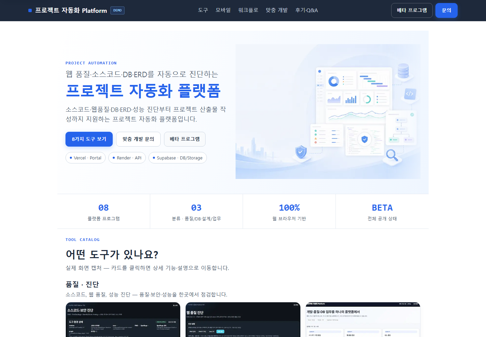

# MyPlatform 공통 — 사용자 매뉴얼

## 1. 개요

**MyPlatform**은 DB 표준 점검, DBManager, 소스·웹 품질 진단, ER Modeler, MyGantt 등 여러 도구를 **웹 브라우저(데스크톱·모바일)** 에서 사용할 수 있게 묶어 둔 포털입니다.

| 항목 | 내용 |
|------|------|
| **접속 URL** | `/` (로컬: `http://127.0.0.1:3000`) |
| **접근** | 기본 공개 모드. `NEXT_PUBLIC_PORTAL_AUTH_REQUIRED=true`로 로그인 보호 모드를 켤 수 있음 |
| **베타 허브** | `/workspace` |
| **상태** | 도구별 베타 운영 |

---

## 2. 화면 구성

### 2.1 공개 홈 (`/`)



현재 홈은 로그인 폼이 아니라 서비스 소개와 도구 카탈로그를 제공하는 공개 마케팅 화면입니다. 상단 메뉴에서 도구·모바일·워크플로·맞춤 개발·후기/Q&A로 이동하고, 첫 화면에서 도구 목록·맞춤 개발 문의·베타 프로그램으로 진입합니다. 아래 도구 카탈로그에는 플랫폼 허브에서 제공하는 8개 도구가 표시됩니다.

### 2.2 로그인과 베타 허브 (`/login`, `/workspace`)

기본 공개 모드에서는 도구 경로를 로그인 없이 열 수 있습니다. `NEXT_PUBLIC_PORTAL_AUTH_REQUIRED=true`로 보호 모드를 설정하면 `/login`에서 포털 암호 또는 발급 코드를 확인하고, 로그인 뒤 `/workspace`로 이동합니다. 관리자(`/admin`)와 IPMS 진단은 별도 인증·암호 보호를 유지합니다.

세션 쿠키가 필요한 보호 모드에서는 로그인 상태를 쿠키로 유지합니다. 보호 모드를 끄면 `/login`은 일반 도구 사용을 위한 필수 단계가 아닙니다.

### 2.3 앱 공통 레이아웃

대부분의 앱 페이지는 다음 패턴을 따릅니다.

1. **상단 바** — 프로젝트 자동화 Platform 허브로 돌아가기, 후기·질문 남기기
2. **Hero** — 앱 이름과 한 줄 설명
3. **패널(panel)** — 설정·실행·결과 영역
4. **메시지 영역** — 진행 상태, 오류, 완료 안내

ER Modeler, MyGantt는 전용 상단 바를 사용합니다.

---

## 3. 등록된 프로그램 목록

| 이름 | 경로 | 분류 |
|------|------|------|
| 소스코드·보안 진단 | `/apps/source-scan` | 품질 |
| 웹 품질 진단 | `/apps/web-quality` | 품질 |
| 성능 진단 | `/apps/perf-test` | 품질 |
| DB 표준 점검 | `/apps/chk-db-std` | DB·설계 |
| DBManager | `/apps/db-manager` | DB·설계 |
| ER Modeler | `/apps/er-modeler` | DB·설계 |
| DeliverableManager | `/apps/deliverable-manager` | 업무 |
| ReceiptToPDF | `/apps/receipt-to-pdf` | 별도 모바일 도구 |
| MyGantt | `/apps/my-gantt` | 업무 |

ReceiptToPDF는 플랫폼 도구 허브의 8개 카드에는 포함되지 않으며 직접 경로(`/apps/receipt-to-pdf`)로 열 수 있습니다.

---

## 4. API 연동 방식 (작동 원리)

```
브라우저 → Next.js 포털 (/api/backend/...) → FastAPI (apps/api)
```

| 상황 | 동작 |
|------|------|
| **로컬 개발** | 포털이 `NEXT_PUBLIC_API_BASE_URL`로 API 프록시 |
| **Vercel 배포** | 동일 프록시 또는 대용량 업로드 시 API 직접 연결 |
| **인증** | 포털 쿠키 + `X-Api-Key` 헤더 |

API가 필요한 앱: 소스코드·보안 진단, 웹 품질 진단, 성능 진단, DB 표준 점검, DBManager, ER Modeler(가져오기/내보내기).

브라우저 로컬 저장 기능: ReceiptToPDF 처리·PDF 백업, ER Modeler 프로젝트, MyGantt 로컬 프로젝트. DeliverableManager는 Supabase에서 카탈로그를 읽고 작성 상태는 현재 브라우저에 저장합니다.

---

## 5. 사용 방법 (처음 시작)

1. 포털을 공개 모드로 쓸지, `NEXT_PUBLIC_PORTAL_AUTH_REQUIRED=true`로 로그인 보호 모드를 쓸지 정합니다.
2. 브라우저에서 포털 주소를 열고 홈의 도구 카탈로그에서 프로그램을 선택합니다.
3. 보호 모드일 때는 `/login`에 표시되는 암호 또는 발급 코드 입력 방식으로 로그인한 뒤 `/workspace`에서 프로그램을 엽니다.
4. 각 도구 화면의 상단 링크를 눌러 포털 허브로 돌아갑니다. ReceiptToPDF는 도구 허브와 별도 경로입니다.

---

## 6. 데이터 보관 정책

| 데이터 종류 | 보관 위치 |
|-------------|-----------|
| 공통 샘플 Excel, 표준 CSV | Supabase Storage |
| 진단 이력 (소스·웹 품질·성능) | API 서버 `data/*_history/` (파일 JSON) |
| ER Modeler / MyGantt 프로젝트 | 브라우저 IndexedDB·localStorage |
| ReceiptToPDF | 브라우저 IndexedDB + 기기 다운로드 폴더 |
| DeliverableManager 작성 상태 | 브라우저 localStorage |

---

## 7. 자주 묻는 질문

**Q. API 연결 오류가 납니다.**  
A. `NEXT_PUBLIC_API_BASE_URL`이 올바른지, API 서버(`uvicorn`)가 실행 중인지 확인하세요.

**Q. 로그인이 안 됩니다.**  
A. 로그인 보호 모드인지 확인하세요. 보호 모드에서는 `PORTAL_PASSWORD` 또는 발급 코드 설정이 필요합니다. 공개 모드라면 일반 도구 사용에 로그인이 필요하지 않습니다.

**Q. 모바일에서도 쓸 수 있나요?**  
A. 포털 UI는 반응형입니다. 소스·웹 품질·성능 진단은 API 서버가 필요하며, 대용량 ZIP과 부하 테스트는 PC 사용을 권장합니다.
