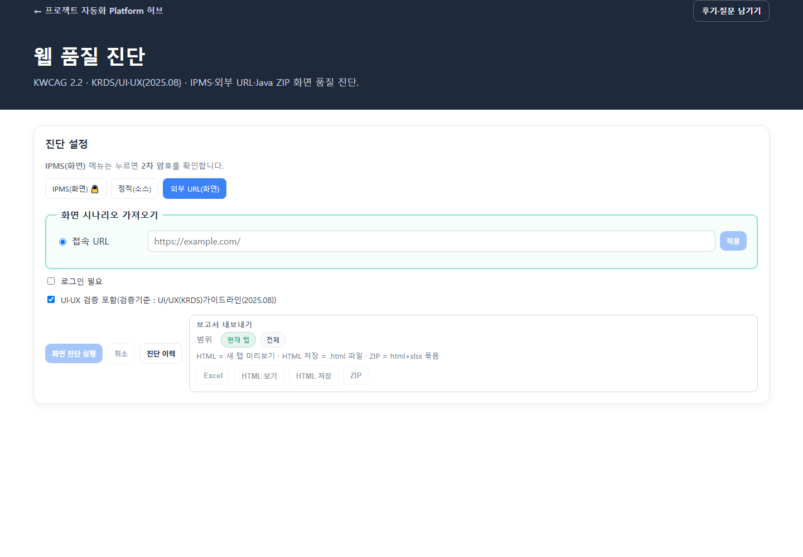

# 웹 품질 진단 — 사용자 매뉴얼

## 1. 개요

| 항목 | 내용 |
|------|------|
| **프로그램명** | 웹 품질 진단 |
| **URL** | `/apps/web-quality` |
| **부가 화면** | `/apps/web-quality/history` (진단 이력) |
| **목적** | KWCAG 2.2, 전자정부 웹표준·호환·접근성 + **KRDS/UI·UX 가이드라인(2025.08)** 화면·소스 품질 진단 |
| **엔진** | 정적 분석(TSX/JSP/HTML) + Playwright + axe-core |



---

## 2. 화면 구성

### 2.1 제목과 환경 상태

- 제목 아래에 KWCAG 2.2, KRDS/UI·UX(2025.08), IPMS·외부 URL·Java ZIP 진단 범위를 표시합니다.
- Playwright 환경 패널은 브라우저 런타임 사용 가능 여부와 미설치 안내를 보여 줍니다.

### 2.2 진단 모드

화면에는 다음 3개 모드가 탭으로 표시됩니다. IPMS는 정식 로그인 자격이 있더라도 화면에서 2차 암호를 확인해야 열립니다. 잠겨 있으면 기본으로 외부 URL 모드가 선택됩니다.

| 화면 탭 | 기능 |
|----------|------|
| **IPMS(화면)** | IPMS 온라인 메뉴를 열어 공개·로그인 시나리오를 점검합니다. 2차 암호가 필요합니다. |
| **정적(소스)** | Java/WAR ZIP 안의 JSP·HTML을 정적으로 점검합니다. 배포 URL을 추가하면 화면 런타임 점검도 선택할 수 있습니다. |
| **외부 URL(화면)** | 외부 웹 주소에서 화면 시나리오를 가져오고 선택한 페이지를 점검합니다. |

Java ZIP은 별도의 네 번째 탭이 아니라 **정적(소스)** 모드에서 입력하는 대상입니다.

### 2.3 진단 설정 패널

기본 IPMS URL: `http://14.35.194.178:12000/ipms.online/`

#### 모드별 입력 필드

| 모드 | 주요 입력 |
|------|-----------|
| IPMS(화면) | IPMS URL, 공개·로그인 시나리오, 필요 시 세션 |
| 정적(소스) | Java/WAR ZIP, JSP·HTML 정적 검사, 선택 배포 URL·화면 진단 |
| 외부 URL(화면) | 접속 URL, 시나리오 가져오기, 로그인 필요 여부·세션 |

#### 시나리오 패널

- **화면 후보 목록** — 체크박스로 진단할 화면 선택
- 각 후보: `state_id`, 라벨, kind(화면/탭/다이얼로그), risk(위험 동작 표시)
- **전체 선택 / 권장만 / 해제** 버튼

#### 실행·내보내기 버튼

| 버튼 | 기능 |
|------|------|
| **정적 진단 실행 / 화면 진단 실행 / IPMS 진단 실행** | 현재 모드와 선택한 입력에 따라 실행 |
| **진단 취소** | 실행 중 job 취소 |
| **진단 이력** | 과거 결과 팝업 |
| **Excel / HTML / ZIP** | 보고서 내보내기 |

### 2.4 진단 결과 패널

| 영역 | 설명 |
|------|------|
| **통계** | pass/fail/review/manual/not_scanned 건수 |
| **결과 탭** | 아래 표 |
| **Findings 테이블** | 규칙, 카테고리, 상태, 위치, 개선안 |
| **화면캡처 그리드** | 전체 페이지·위반 요소 스크린샷 |

#### 결과 탭

| 탭 | 내용 |
|----|------|
| **전체** | 모든 findings |
| **웹표준** | standard |
| **웹호환성** | compat (JS 콘솔 오류 등) |
| **웹접근성** | a11y (KWCAG/axe) |
| **UI·UX(KRDS)** | uiux (디지털 정부 UIUX 가이드라인 2025.08) |
| **화면캡처** | PNG 스크린샷 |
| **Diff 신규** | 이전 진단 대비 신규 결함 |
| **미실행** | not_scanned |
| **수동/해당없음** | manual, na |

---

## 3. 기능 상세

### 3.1 진단 레이어 (작동 방식)

| 레이어 | 대상 | 방법 |
|--------|------|------|
| **정적** | TSX, JSP, HTML 소스 | 정규식·휴리스틱 (alt, lang, label 등) |
| **런타임** | 실제 브라우저 화면 | Playwright → axe-core WCAG 검사 + 콘솔 오류 + 캡처 |

```
시나리오 선택 → (정적 스캔) → Playwright로 각 화면 열기 → axe 실행 → findings 병합 → 보고서
```

### 3.2 IPMS 공개 시나리오 (자동 제공)

메뉴 트리 분석 기반 **사전 정의 시나리오**:

| 그룹 | 예시 화면 |
|------|-----------|
| **알림마당** | 공지사항, FAQ, Q&A, 자료실, 카드뉴스 |
| **이용안내** | 발전사업절차, 시스템 안내 |
| **통계분석** | 공개 주제도, 통계/전망 대시보드 |
| **기본** | 홈(GNB·푸터), 로그인 폼 |

각 시나리오는 GNB 클릭 스텝(`click_has_text`, `wait .section-wrap`)으로 화면을 엽니다.

### 3.3 IPMS 로그인 시나리오

| 그룹 | 예시 |
|------|------|
| **민원신청** | 전기사업허가, 공사계획신고, 사업개시신고 등 |
| **주민수용성** | 의견수렴공고, 내 의견 관리 |
| **내정보관리** | 회원관리, 민원현황 |

**세션 준비 (3가지 방법):**

1. 터미널: `python scripts/save_ipms_session.py` → JSON 생성
2. **세션 JSON 파일 업로드** (`storage_state`)
3. (개발 PC) **로그인 세션 생성** — Chromium 수동 로그인 후 저장

공동인증서 2단계는 자동화되지 않습니다. 로그인 완료 **이후** 세션을 저장해야 합니다.

### 3.4 정적(소스) 모드의 Java ZIP

1. Java/WAR 프로젝트 ZIP 업로드
2. **ZIP에서 시나리오 읽기** — Spring `@GetMapping` + JSP/HTML에서 페이지 후보 추출
3. **정적 진단** — JSP/HTML 마크업 규칙
4. (선택) **배포 URL** + Playwright — 실제 서버에 올린 앱 런타임 진단

### 3.5 외부 URL 모드

1. 진단 URL 입력
2. **화면 시나리오 가져오기** (async discover job)
   - 같은 도메인 링크 크롤 (최대 ~35)
   - `data-wq-target` 요소 탐지
   - 포털 앱 URL이면 소스 기반 시나리오 병합
3. 위험 동작(파일선택, confirm, destructive)은 risk 표시·기본 제외
4. 로그인 필요 시 세션 생성/업로드

### 3.6 규칙 체계

| 파일 | 내용 |
|------|------|
| KWCAG 2.2 | `kwcag22.json` — 한국형 웹 콘텐츠 접근성 |
| eGov 웹 | `egov_web.json` — WS/WC/WA 표준 |
| axe 매핑 | axe 규칙 → KWCAG → eGov 연결 |
| Fix guides | 한글 개선안 (`axe_fix_ko.json`) |

Finding 상태: `pass`, `fail`, `review`, `manual`, `not_scanned`, `na`

---

## 4. 사용 방법 (단계별)

### 4.1 IPMS 공개 진단

1. **IPMS(화면)** 탭 선택
2. IPMS URL 확인 (기본값 또는 수정)
3. 시나리오 목록 자동 로드 → 진단할 메뉴 체크
4. **진단 실행** → job 완료까지 대기
5. **웹접근성** / **화면캡처** 탭 확인
6. **Excel** 또는 **ZIP** 내보내기

### 4.2 IPMS 로그인 화면 진단

1. 정식 로그인 후 **IPMS(화면)** 탭의 2차 암호를 통과합니다.
2. IPMS 메뉴에서 로그인 시나리오를 선택합니다. 대상 시스템에서 별도 로그인이 필요하면 세션을 준비합니다.
3. **IPMS 진단 실행**을 눌러 결과를 확인합니다.

### 4.3 외부 URL 진단

1. **외부 URL(화면)** 탭
2. URL 입력 → **화면 시나리오 가져오기**
3. (필요) 로그인 세션 설정
4. 시나리오 선택 → **진단 실행**

### 4.4 Java ZIP 정적 진단

1. **정적(소스)** 탭을 선택하고 Java/WAR ZIP을 올립니다.
2. JSP·HTML 정적 검사 대상을 확인합니다.
3. (선택) 배포 URL을 입력하고 화면 진단 포함을 선택합니다.
4. **정적 진단 실행** 또는 정적·화면 진단 버튼을 누릅니다.

---

## 5. 입력·출력

| 구분 | 형식 |
|------|------|
| **입력** | URL, Java ZIP, session JSON |
| **출력** | findings, screenshots, coverage, diff, stats |
| **내보내기** | Excel, HTML, ZIP(html+xlsx) |
| **이력** | job_id, mode, page_url, fail/not_scanned counts |

---

## 6. 환경 요구사항

| 항목 | 설명 |
|------|------|
| Playwright Chromium | API 서버에 설치 필수 (런타임) |
| `PORTAL_PASSWORD` | API env — 포털 앱 Playwright 로그인용 |
| 네트워크 | IPMS·외부 URL은 대상 서버 접근 가능해야 함 |

---

## 7. 주의사항

- **성능(부하) 검사 아님** — 접근성·표준이 목적 (응답시간/TPS 미수집)
- IPMS auth는 **운영 계정·공동인증** 주의 — 테스트 계정 권장
- destructive risk 시나리오(삭제·업로드)는 기본 미선택
- async job은 API 재시작 시 진행 중 job 소실 가능

---

## 8. 다른 프로그램과의 연계

- **MyGantt** 등 포털 앱 TSX에 `data-wq-target` / `data-wq-state` 훅을 두면 시나리오 추출 정확도 향상
- 상세: `apps/api/web_quality/docs/my-gantt-scenario-guide.md`

### 8.1 시나리오 정의 방식 (모드별)

| 모드 | 시나리오 출처 | 납품·감사 권장 |
|------|---------------|----------------|
| IPMS 공개/로그인 | 코드 프리셋 (`ipms_online.py`) — URL은 접속 주소만 | ★★★ 고정 프리셋 유지 |
| Java ZIP | ZIP 내 JSP/Controller 분석 | ★★ 추출 후 범위 고정 |
| 외부 URL | Playwright **「화면 시나리오 가져오기」** (링크·data-wq 탐색) | ★ 조사용 — 납품 전 프리셋으로 동결 |
| (포털 앱 직접) | manifest + 소스 추출 (MyGantt 등) | ★★★ manifest + Git 버전 |

**성능 진단**(`/apps/perf-test`)은 IPMS·포털 앱에서 **동일 후보 목록**을 쓰지만, 외부 URL 자동 탐색은 없습니다. 통합 로드맵: [diagnostics-scenario-roadmap.md](../diagnostics-scenario-roadmap.md)
