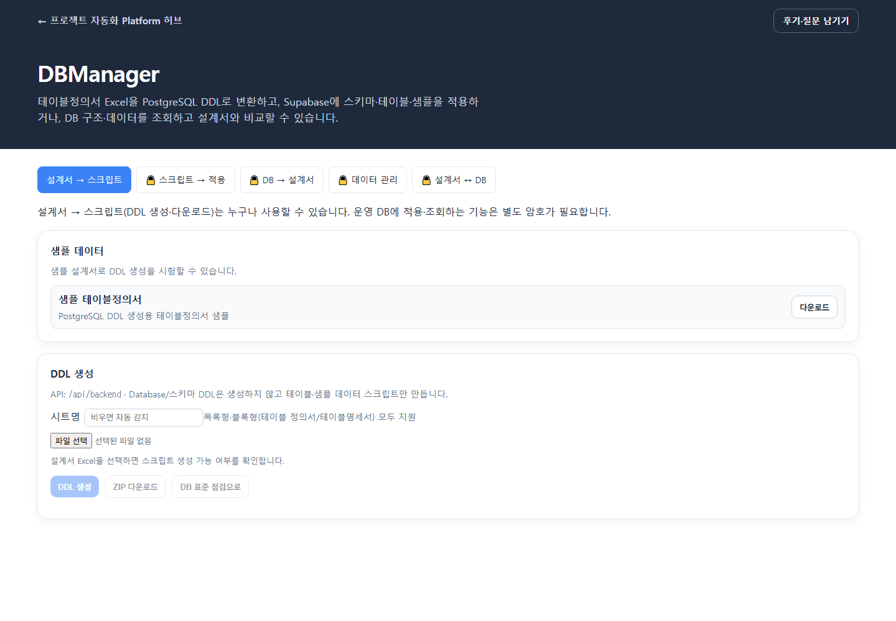

# DBManager — 사용자 매뉴얼

## 1. 개요

| 항목 | 내용 |
|------|------|
| **프로그램명** | DBManager |
| **URL** | `/apps/db-manager` |
| **목적** | 테이블정의서(Excel) → PostgreSQL DDL 생성, Supabase/Postgres 적용, 데이터 관리, 설계서↔DB 동기화 |
| **DB** | PostgreSQL (Supabase 연결 권장) |



---

## 2. 화면 구성 — 5개 메인 탭

| 탭 | 이름 | 역할 |
|----|------|------|
| 1 | **설계서 → 스크립트** | Excel → CREATE TABLE + sample INSERT |
| 2 | **스크립트 → 적용** | DB에 테이블·샘플 데이터 실행 |
| 3 | **DB → 설계서** | DB 스키마 → Excel 역반영 |
| 4 | **데이터 관리** | 테이블 데이터 조회·수정·업로드 |
| 5 | **설계서 ↔ DB** | diff 비교 + ALTER 실행 |

상단에는 허브로 돌아가는 링크와 DBManager 소개가 표시됩니다. 선택된 탭 외에 운영 DB를 조회·변경하는 탭에는 자물쇠가 표시됩니다. 잠긴 기능은 별도 DB 암호로 해제해야 하며, 서버에 암호가 설정되지 않으면 열리지 않습니다.

---

## 3. 탭별 기능 상세

### 3.1 설계서 → 스크립트

| UI / 기능 | 설명 |
|-----------|------|
| **샘플 테이블정의서** | API 제공 sample xlsx 다운로드 |
| **Excel 업로드** | `.xlsx` 선택 |
| **자동 검증** | 시트명, 설계서 형식, 테이블·컬럼 수 표시 |
| **DDL 생성** | CREATE TABLE + sample INSERT SQL 생성 |
| **테이블 목록** | 영문 테이블명, 한글명, 스키마, 컬럼 수 |
| **스크립트 탭** | 파일별 SQL 미리보기 |
| **ZIP 다운로드** | 전체 DDL 스크립트 묶음 |
| **DB 표준 점검으로** | chk-db-std handoff (IndexedDB) |

**작동 방식:** Excel 파싱 → 테이블·컬럼 메타 추출 → PostgreSQL DDL + 샘플 INSERT 생성. 설계서 변환과 스크립트 다운로드는 잠금 없이 이용할 수 있습니다.

**주의:** Database/스키마 생성 DDL은 **포함하지 않음** — 테이블 + 샘플 INSERT만.

### 3.2 스크립트 → 적용

| UI / 기능 | 설명 |
|-----------|------|
| **DB 연결 상태** | 잠금 해제 뒤 연결된 DB 확인 |
| **Database명** | 연결된 DB 이름 표시 |
| **적용 스키마** | dropdown — SQL이 이 스키마로 rewrite |
| **Step 1: 테이블 생성** | CREATE TABLE 일괄 실행 |
| **Step 2: 샘플 데이터** | INSERT (PK 자동 재부여) |
| **최근 적용 이력** | 메타만 (SQL 본문 미보관) |

**작동 방식:** 1단계에서 생성한 scripts[]를 선택 스키마에 맞게 변환 후 트랜잭션 실행.

### 3.3 DB → 설계서

| UI / 기능 | 설명 |
|-----------|------|
| **양식 Excel (template)** | 반드시 업로드 — 출력 양식 |
| **Database명 label** | DB 이름 표기용 |
| **스키마 선택** | 대상 스키마 |
| **테이블 다중 선택** | export 대상 |
| **설계서 다운로드** | DB 구조를 template에 병합한 xlsx |

**용도:** DB가 source of truth일 때 설계서를 최신화.

### 3.4 데이터 관리

| UI / 기능 | 설명 |
|-----------|------|
| **스키마 / 테이블** | dropdown 선택 |
| **검색 (q)** | 텍스트 필터 |
| **페이지네이션** | 100행/페이지 |
| **행 수정·삭제** | PK 기준 인라인 편집 |
| **CSV/xlsx/json export** | API format 파라미터 |
| **CSV/Excel 업로드** | preview → conflict 정책 |
| **Conflict 정책** | skip / update / renumber / insert |
| **업로드 오류 CSV** | 실패 행 다운로드 |

### 3.5 설계서 ↔ DB

| UI / 기능 | 설명 |
|-----------|------|
| **설계서 업로드** | Excel |
| **비교 실행** | 설계서 vs live DB |
| **changes 테이블** | kind, severity, table, column, detail |
| **통계** | new_tables, add_columns, type_changes 등 |
| **safe_sql** | 위험 낮은 ALTER |
| **caution_sql** | 타입 변경, NOT NULL 등 주의 ALTER |
| **caution 포함** | checkbox |
| **검증만 (dry_run)** | SQL 미실행 |
| **ALTER 실행** | caution 선택 시 실제 적용 |

---

## 4. 사용 방법 — 전체 워크플로

### 4.1 신규 프로젝트 (설계서 → DB)

1. **설계서 → 스크립트** — Excel 업로드 → **DDL 생성**
2. (선택) **DB 표준 점검으로** — 명명 표준 확인
3. **스크립트 → 적용** — 스키마 선택 → **테이블 생성** → **샘플 데이터**
4. **데이터 관리** — CSV로 실데이터 업로드

### 4.2 DB 변경 후 설계서 맞추기

1. **DB → 설계서** — template + 테이블 선택 → 다운로드

### 4.3 설계서 변경 후 DB 맞추기

1. **설계서 ↔ DB** — Excel 업로드 → **비교**
2. safe/caution SQL 검토 → **검증만** 또는 **ALTER 실행**

---

## 5. 작동 방식 (아키텍처)

```
Portal UI → /api/backend/v1/db-manager/*
    → apps/api/dbmanager/ (Excel parse, DDL gen, psycopg2)
    → PostgreSQL (Supabase)
```

이벤트 로그: `run_events` 테이블 (적용·diff 등 메타).

---

## 6. 입력·출력

| 구분 | 형식 |
|------|------|
| **입력** | `.xlsx` 테이블정의서; CSV/xlsx 데이터 |
| **출력** | JSON scripts[], ZIP ddl, Excel design export |
| **DB** | CREATE, INSERT, ALTER, SELECT, UPDATE, DELETE |

---

## 7. 환경 요구사항

| 변수 | 필수 | 설명 |
|------|------|------|
| `DATABASE_URL` | 적용/데이터/diff/reverse 시 | Postgres connection string |
| Transaction pooler | 비권장 | DDL은 direct connection 권장 |

샘플: `apps/api/samples/dbmanager/design.sample.xlsx`

---

## 8. 접근 제어와 주의사항

- **스크립트 → 적용**, **DB → 설계서**, **데이터 관리**, **설계서 ↔ DB**는 운영 데이터에 접근할 수 있어 별도 잠금 암호가 필요합니다. `DB_UNLOCK_PASSWORD`가 서버에 설정되지 않으면 사용할 수 없습니다.
- **caution_sql**은 데이터 손실 가능 — dry_run 먼저
- production DB에 직접 ALTER 전 백업 권장
- handoff로 넘긴 설계서는 브라우저 IndexedDB — 다른 기기에서는 재업로드 필요
