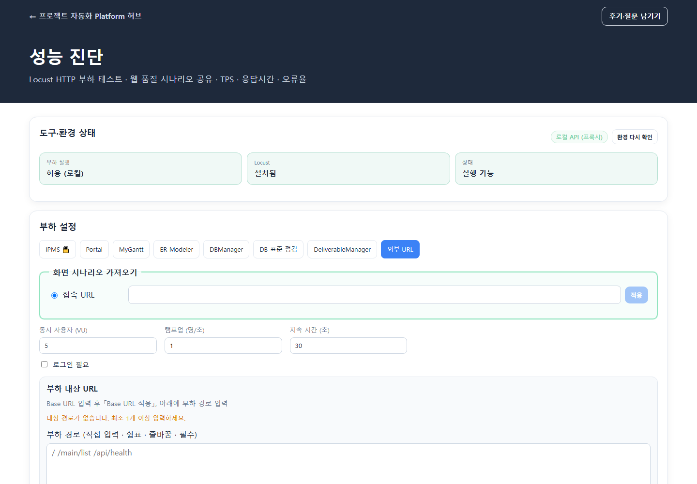

# 성능 진단 — 사용자 매뉴얼

## 1. 개요

| 항목 | 내용 |
|------|------|
| **프로그램명** | 성능 진단 |
| **URL** | `/apps/perf-test` |
| **목적** | Locust로 HTTP 부하를 발생시켜 처리량, 응답시간, 오류율을 측정 |
| **대상** | IPMS, 포털 앱, ER Modeler, DBManager, DB 표준 점검, DeliverableManager, 직접 입력한 외부 URL |
| **부하 실행** | 로컬 API에서 실행. 클라우드 API에서는 차단될 수 있음 |

## 2. 현재 화면 구성

### 2.1 도구·환경 상태

화면 맨 위에서 부하 실행 허용 여부, Locust 설치 여부, 전체 실행 가능 여부를 확인합니다. **환경 다시 확인**으로 상태를 갱신합니다. 부하 실행이 차단되거나 Locust·API 설정이 빠져 있으면 화면에 실행 안내가 표시됩니다.

### 2.2 부하 설정

상단 탭으로 대상을 고릅니다. IPMS 탭은 2차 암호로 보호되며 잠긴 경우 외부 URL이 기본 선택됩니다.

| 대상 탭 | 입력과 동작 |
|---------|-------------|
| **IPMS** | IPMS 주소 적용, 공개·로그인 시나리오 범위 선택. 로그인 시나리오는 세션이 필요함 |
| **Portal** | 포털 Base URL 적용 후 부하 대상 경로 선택. 목록 새로고침·전체 선택·권장만 선택 지원 |
| **MyGantt / ER Modeler / DBManager / DB 표준 점검 / DeliverableManager** | 앱 화면 시나리오를 가져와 선택 |
| **외부 URL** | Base URL을 적용하고 부하 경로를 직접 입력 |

모든 대상에서 **동시 사용자(VU)**, **램프업(명/초)**, **지속 시간(초)**을 설정합니다. 로그인 필요 항목은 로그인 세션을 준비한 뒤 실행할 수 있습니다.

### 2.3 시나리오와 측정 옵션

- **화면 시나리오 가져오기**에서 URL을 적용해 진단 가능한 경로·시나리오를 불러옵니다.
- 포털 URL 대상은 공개 경로와 로그인 필요 경로가 구분됩니다. 추가 경로를 직접 입력할 수 있습니다.
- **선택 시나리오 미리보기**는 화면을 열어 확인하며, 부하는 발생시키지 않습니다.
- **Playwright HAR 녹화**를 선택하면 실행 직전 브라우저로 HTTP 요청을 기록한 뒤 Locust 측정을 시작합니다. HAR 준비 시간은 TPS와 응답시간 집계에서 제외됩니다.
- **고부하 확인 (VU > 20)**은 동시 사용자 수가 20명을 초과할 때 확인용으로 사용합니다.

### 2.4 결과와 이력

실행 중에는 진행률, 누적 요청 수, 오류율을 확인하고 취소할 수 있습니다. 완료 후 결과 요약에서 다음 지표와 URL별 상세를 확인합니다.

| 지표 | 의미 |
|------|------|
| **TPS (rps)** | 초당 요청 수 |
| **평균 응답 / p95** | 평균 및 95백분위 응답시간 |
| **오류율** | 실패한 요청 비율 |
| **총 요청** | 측정 구간의 요청 수 |
| **VU · 시간** | 실행한 가상 사용자 수와 지속 시간 |

느린 경로에는 p95 기준 조치 힌트가 표시될 수 있습니다. 결과는 HTML·Excel·JSON으로 내보낼 수 있으며 아래 **검사 이력**에서 이전 실행의 일시·대상·VU·rps·오류율을 확인합니다.

## 3. 사용 방법

1. 도구·환경 상태에서 로컬 API와 Locust가 준비됐는지 확인합니다.
2. 부하 설정 탭에서 측정할 대상을 선택하고 접속 URL을 적용합니다.
3. URL 또는 화면 시나리오를 불러와 대상 경로를 선택합니다. 외부 URL은 경로를 직접 입력합니다.
4. VU, 램프업, 지속 시간을 정합니다. 필요하면 로그인 세션이나 HAR 녹화를 준비합니다.
5. **성능검사 실행**을 누르고 진행 상황을 확인합니다.
6. 결과 지표와 URL별 상세를 확인한 뒤 HTML·Excel·JSON으로 저장합니다.

## 4. 환경 요구사항과 주의사항

- 성능검사는 Locust가 설치된 **로컬 FastAPI**에서 실행해야 합니다. 클라우드 API는 부하 실행을 허용하지 않을 수 있습니다.
- 브라우저 포털의 `NEXT_PUBLIC_API_BASE_URL`이 로컬 API를 가리키고, API 환경에 Locust가 설치되어야 합니다.
- 실행은 선택한 서버에 실제 HTTP 요청을 보냅니다. 테스트 권한이 있는 서버와 적절한 부하값을 사용하세요.
- 로그인 필요 시나리오는 세션이 없으면 측정에서 제외될 수 있습니다.
- HAR 녹화 실행 결과는 HAR OFF 결과와 직접 비교하기 어렵습니다. HAR 수집이 실패하면 URL 경로 입력을 이용한 대체 측정이 표시될 수 있습니다.
